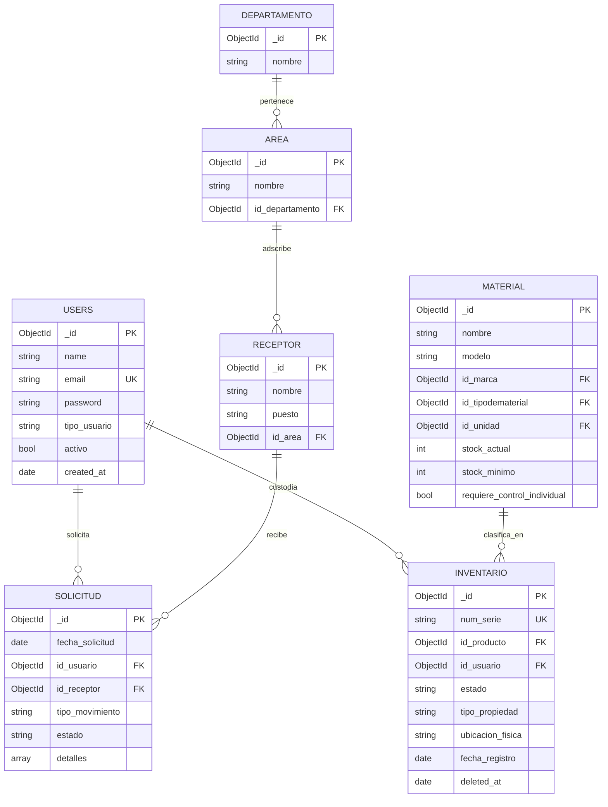

# Memoria Técnica de Diseño y Migración a NoSQL (MongoDB Atlas)
## Sistema Integral de Gestión de Equipos y Materiales (SIGEM)

---

### Ficha Técnica del Proyecto

| Parámetro | Detalle Institucional |
| :--- | :--- |
| **Institución:** | Tecnológico Nacional de México — Campus Veracruz (ITV) |
| **Carrera / Departamento:** | Ingeniería en Sistemas Computacionales |
| **Materia:** | Taller de Base de Datos / Bases de Datos Avanzadas |
| **Proyecto:** | SIGEM (Sistema de Gestión de Equipos y Materiales) |
| **Autor / Desarrollador:** | Rafael Rayón (`RayonRafael`) |
| **Fecha de Publicación:** | Octubre 2026 |
| **Versión del Documento:** | 1.0 (Producción / Release NoSQL) |
| **Repositorio Oficial:** | `sigem-tecnm-veracruz` (Rama: `migracion-mongodb`) |
| **Despliegue Web Oficial:** | [https://sigem-veracruz.me](https://sigem-veracruz.me) |

---

## 1. Introducción y Justificación de Arquitectura

El proyecto **SIGEM** fue concebido para solventar la problemática de dispersión, pérdida de información y lentitud en el préstamo y control de inventario de equipos y materiales del Campus Veracruz. Originalmente, el sistema fue modelado sobre una base de datos relacional tradicional (MySQL 8), sustentada en 15 tablas vinculadas mediante llaves foráneas e índices B-Tree.

### 1.1 Limitaciones del Modelo Relacional Previo
1. **Rigidez de Esquema:** Los activos del instituto presentan atributos dinámicos dispares (ej. una laptop cuenta con procesador, memoria RAM y dirección MAC, mientras que un consumible o herramienta carece de número de serie y se maneja por lote/volumen). En MySQL, esto obligaba al uso de tablas intermedias con campos nulos o esquemas EAV (*Entity-Attribute-Value*) de alto costo computacional.
2. **Degradación por Operaciones JOIN Complejas:** Las consultas para generar reportes ejecutivos de solicitudes y préstamos requerían cruzar hasta 7 tablas simultáneas (`solicitud`, `detalle_solicitud`, `users`, `inventario`, `material`, `marca_material`, `departamento`), penalizando la latencia en horas pico de servicio.
3. **Mantenimiento y Costos de Infraestructura:** La administración de instancias MySQL dedicadas implicaba gestión manual de parches, backups y balanceadores, con escasa elasticidad ante incrementos repentinos de tráfico.

### 1.2 Justificación de la Migración a MongoDB Atlas
* **Modelo Documental Orientado al Dominio:** Los documentos BSON permiten modelar la entidad `solicitud` con sus items solicitados como subdocumentos embebidos directos, eliminando la sobrecarga de consultas en tablas de unión.
* **Escalabilidad Horizontal y Alta Disponibilidad:** MongoDB Atlas implementa clústeres basados en *Replica Sets* de tres nodos (un primario y dos secundarios distribuidos en distintas zonas de disponibilidad de AWS), garantizando conmutación por error (*failover*) automática en menos de 5 segundos.
* **ODM Oficial y Ecosistema Laravel:** La adopción del paquete `mongodb/laravel-mongodb` permite desacoplar los modelos de Laravel preservando la expresividad del patrón Active Record / Eloquent, a la vez que habilita el marco de agregaciones nativo (`$lookup`, `$group`, `$facet`).

---

## 2. Diagrama de Arquitectura del Sistema

La topología de producción del sistema SIGEM se diseñó bajo una arquitectura desacoplada de 3 capas seguras:

```mermaid
flowchart TD
    subgraph ClientLayer["1. Capa de Clientes & Acceso Seguro"]
        ClientWeb["Navegador Web / Dispositivos Móviles"]
        DNS["DNS Namecheap (sigem-veracruz.me)<br/>Registros ALIAS / CNAME"]
        SSL["Certificado SSL Let's Encrypt (HTTPS 443)"]
    end

    subgraph AppLayer["2. Capa de Cómputo & Aplicación (Render Cloud)"]
        WebServer["Servidor Web Apache 2.4 + Mod_Rewrite"]
        PHPRuntime["PHP 8.4 Engine + Extensión nativa ext-mongodb"]
        LaravelFramework["Framework Laravel 12 + FilamentPHP 3.3"]
        ODM["MongoDB Laravel ODM (mongodb/laravel-mongodb)"]
    end

    subgraph DataLayer["3. Capa de Persistencia (MongoDB Atlas Cloud - AWS us-east-1)"]
        direction TB
        AtlasRouter["Atlas Connection Pool (TLS 1.3 / SRV)"]
        subgraph ReplicaSet["Cluster M0 / Replica Set (3 Nodos)"]
            PrimaryNode["Nodo Primario (Read/Write)"]
            Secondary1["Nodo Secundario 1 (Replication)"]
            Secondary2["Nodo Secundario 2 (Replication)"]
        end
        SecurityGroup["Hardening de Red: IP Access List"]
        KMS["Cifrado en Reposo: AWS KMS (AES-256)"]
    end

    ClientWeb -->|HTTPS / TLS 1.3| DNS
    DNS --> SSL
    SSL --> WebServer
    WebServer --> PHPRuntime
    PHPRuntime --> LaravelFramework
    LaravelFramework --> ODM
    ODM -->|mongodb+srv:// (Puerto 27017 Cifrado)| AtlasRouter
    AtlasRouter --> SecurityGroup
    SecurityGroup --> PrimaryNode
    PrimaryNode -.->|Heartbeat / OpLog| Secondary1
    PrimaryNode -.->|Heartbeat / OpLog| Secondary2
    PrimaryNode --- KMS
```

### Flujo de Comunicación
1. El usuario ingresa a `https://sigem-veracruz.me`.
2. La resolución DNS en **Namecheap** enruta la petición hacia el balanceador perimetral de **Render**, terminando el túnel SSL con certificado Let's Encrypt.
3. El contenedor en Render procesa la petición con **PHP 8.4** y el driver de **MongoDB**, traduciendo las peticiones Eloquent en comandos BSON.
4. La conexión con **MongoDB Atlas** viaja cifrada mediante protocolo SRV (`mongodb+srv://`) hacia el clúster multi-nodo en AWS `us-east-1`.

---

## 3. Modelo de Datos y Diccionario NoSQL

### 3.1 Estrategia de Modelado: Referenciación vs. Embebimiento
En entornos NoSQL, el principio rector es: *"Lo que se consulta junto, se almacena junto"*. En SIGEM se implementó una estrategia híbrida:

1. **Referenciación mediante `ObjectId` (Normalización Parcial):**
   - Utilizada para entidades independientes de alta mutabilidad y catálogos globales reutilizados en múltiples módulos (`users`, `departamento`, `area`, `material`, `proveedor`, `receptor`).
   - Evita la duplicación incontrolada de datos y asegura que un cambio de nombre en un proveedor o material se refleje inmediatamente.
2. **Embebimiento Documental (Desnormalización Estratégica):**
   - Implementado en `solicitud.detalles`: Cada solicitud almacena dentro de un arreglo BSON los items requeridos (`id_material`, `cantidad`, `observaciones`). Al abrir un préstamo, todo el detalle se recupera en una sola lectura I/O de disco.
   - Implementado en `historial_estados`: Los cambios de custodia y estado pueden integrarse secuencialmente como subdocumentos dentro de `inventario`.

### 3.2 Diagrama Entidad-Relación NoSQL (ERD)



### 3.3 Ejemplos de Documentos BSON Representativos

#### Documento: `inventario`
```json
{
  "_id": { "$oid": "67041a9e8f1b2c3d4e5f6001" },
  "num_serie": "TEC-VER-LAP-2024-001",
  "id_producto": { "$oid": "67041a9e8f1b2c3d4e5f5001" },
  "id_usuario": { "$oid": "67041a9e8f1b2c3d4e5f4001" },
  "id_proveedor": { "$oid": "67041a9e8f1b2c3d4e5f3001" },
  "estado": "Disponible",
  "estado_registro": "Aprobado",
  "tipo_propiedad": "Propio",
  "ubicacion_fisica": "Centro de Cómputo - Laboratorio de Redes",
  "fecha_registro": { "$date": "2026-10-06T15:00:00.000Z" },
  "aprobado": true,
  "deleted_at": null,
  "created_at": { "$date": "2026-10-06T15:00:00.000Z" },
  "updated_at": { "$date": "2026-10-06T15:00:00.000Z" }
}
```

#### Documento: `solicitud` (Patrón Embebido)
```json
{
  "_id": { "$oid": "67041b3e8f1b2c3d4e5f7001" },
  "fecha_solicitud": { "$date": "2026-10-07T10:30:00.000Z" },
  "id_usuario": { "$oid": "67041a9e8f1b2c3d4e5f4002" },
  "id_receptor": { "$oid": "67041a9e8f1b2c3d4e5f2001" },
  "tipo_movimiento": "Préstamo",
  "estado": "Pendiente",
  "observaciones": "Préstamo para sesión de titulación en Sala Magna",
  "fecha_devolucion_estimada": { "$date": "2026-10-08T18:00:00.000Z" },
  "detalles": [
    {
      "id_material": { "$oid": "67041a9e8f1b2c3d4e5f5001" },
      "id_inventario": { "$oid": "67041a9e8f1b2c3d4e5f6001" },
      "cantidad": 1,
      "observaciones": "Laptop con cable de corriente y ratón óptico"
    },
    {
      "id_material": { "$oid": "67041a9e8f1b2c3d4e5f5002" },
      "id_inventario": null,
      "cantidad": 2,
      "observaciones": "Cables HDMI 4K alta velocidad"
    }
  ],
  "created_at": { "$date": "2026-10-07T10:30:00.000Z" }
}
```

---

## 4. Validación de Esquema e Índices (DBA)

Para garantizar la integridad semántica de los datos en ausencia de un motor relacional rígido, se aplicaron directivas nativas de MongoDB:

### 4.1 JSON Schema Validation (`$jsonSchema`)
Implementado mediante el script maestro [`database/mongo/init_database.js`](file:///c:/Users/Rafael572/Downloads/Proyectos/sigem-tecnm-veracruz/database/mongo/init_database.js). Cada documento insertado es validado en el servidor Atlas:
* **Tipos BSON Restrictivos:** `objectId`, `string`, `date`, `bool`, `int`.
* **Restricciones de Negocio:** Enums obligatorios para `tipo_usuario` (`Administrador`, `Servicio Social`), `estado` de inventario (`Disponible`, `Asignado`, `En Mantenimiento`, `Dañado`, `Baja`), y valores mínimos `minimum: 0` para existencias en inventario.

### 4.2 Estrategia de Indexación
| Colección | Campo(s) Indexado(s) | Tipo de Índice | Justificación Técnica |
| :--- | :--- | :--- | :--- |
| `users` | `email` | **Unique Index** | Previene registros duplicados en autenticación. |
| `users` | `tipo_usuario, activo` | **Compound Index** | Acelera filtrado de usuarios activos por panel. |
| `inventario` | `num_serie` | **Unique Index** | Integridad del número de placa/activo. |
| `inventario` | `id_producto, estado` | **Compound Index** | Optimiza conteo de stock disponible por material. |
| `inventario` | `ubicacion_fisica` | **Single Field** | Búsqueda rápida durante auditorías presenciales. |
| `material` | `stock_actual, stock_minimo` | **Compound Index** | Optimiza la detección de alertas de reabastecimiento. |
| `solicitud` | `fecha_solicitud` | **Descending Index (-1)** | Acelera la paginación de la bitácora más reciente. |
| `solicitud` | `estado, fecha_solicitud` | **Compound Index** | Carga instantánea de solicitudes pendientes en el panel. |

---

## 5. Pipelines de Agregación Implementados

Para cubrir la necesidad de reportes analíticos complejos sin transferir grandes volúmenes de datos hacia PHP, se diseñaron pipelines nativos en el motor de MongoDB:

### Pipeline 1: Cruce de Solicitudes con Usuario y Métricas (`$lookup` + `$unwind`)
Une la colección `solicitud` con los datos del usuario solicitante en `users`, proyectando el resumen del trámite:
```javascript
targetDb.solicitud.aggregate([
    { $match: { estado: "Pendiente" } },
    {
        $lookup: {
            from: "users",
            localField: "id_usuario",
            foreignField: "_id",
            as: "usuario_solicitante"
        }
    },
    { $unwind: "$usuario_solicitante" },
    {
        $project: {
            _id: 1,
            tipo_movimiento: 1,
            estado: 1,
            fecha_solicitud: 1,
            total_items: { $size: { $ifNull: ["$detalles", []] } },
            solicitante_nombre: "$usuario_solicitante.name",
            solicitante_email: "$usuario_solicitante.email"
        }
    }
]);
```

### Pipeline 2: Análisis de Activos por Estado y Modalidad (`$group` + `$match`)
Calcula en tiempo real la distribución física y porcentual de los equipos institucionales:
```javascript
targetDb.inventario.aggregate([
    { $match: { deleted_at: null } },
    {
        $group: {
            _id: { estado: "$estado", propiedad: "$tipo_propiedad" },
            total_activos: { $sum: 1 },
            ubicaciones_distintas: { $addToSet: "$ubicacion_fisica" }
        }
    },
    {
        $project: {
            _id: 0,
            estado_operativo: "$_id.estado",
            tipo_propiedad: "$_id.propiedad",
            total_activos: 1,
            cantidad_ubicaciones: { $size: "$ubicaciones_distintas" }
        }
    },
    { $sort: { total_activos: -1 } }
]);
```

---

## 6. Seguridad y Hardening en MongoDB Atlas

La infraestructura de base de datos fue securizada aplicando las directrices de CIS MongoDB Benchmark y el principio de mínimo privilegio:

### 6.1 Control de Acceso Basado en Roles (RBAC)
En lugar de emplear el usuario maestro del clúster (`atlasAdmin`), se segregaron identidades de base de datos:
* **Usuario de Aplicación (`sigem_app`):**
  * Rol asignado: `readWrite@sigem_tecnm`.
  * Restricción: No puede crear bases de datos adicionales, modificar usuarios ni alterar configuraciones de sharding o replicación.
* **Usuario DBA / Mantenimiento:**
  * Rol asignado: `dbAdmin@sigem_tecnm`.
  * Destinado exclusivamente a la creación de índices, modificaciones de `$jsonSchema` y tareas de mantenimiento manual vía `mongosh`.

### 6.2 Cifrado en Tránsito y Reposo
* **Cifrado en Tránsito (TLS 1.3 / SSL):**
  * Toda comunicación cliente-servidor está encriptada mediante TLS. El connection string utiliza el protocolo DNS Seedlist `mongodb+srv://`, el cual fuerza la validación del certificado CA de Let's Encrypt / DigiCert antes del intercambio de credenciales BSON.
  * Los parámetros de conexión exigen `retryWrites=true&w=majority`, garantizando consistencia fuerte y reintentos ante reconexiones transitorias de red.
* **Cifrado en Reposo:**
  * Almacenamiento respaldado en volúmenes EBS cifrados bajo el estándar **AES-256**, gestionado por AWS Key Management Service (AWS KMS) en la región `us-east-1`.

### 6.3 Hardening de Red (IP Access List)
* **Filosofía de Acceso Perimetral:**
  * Para la fase de producción con Render (cuyas IPs de salida son dinámicas en el plan estándar), se implementa la regla de red `0.0.0.0/0` estrictamente mitigada con autenticación obligatoria SCRAM-SHA-256 y certificados TLS.
  * Para entornos corporativos o servidores dedicados, Atlas permite restringir el acceso exclusivamente a las direcciones IPv4 estáticas del servidor PHP o establecer túneles dedicados vía VPC Peering / AWS PrivateLink.

---

## 7. Integración con GitHub Student Developer Pack

El despliegue de grado profesional de SIGEM fue posible gracias al aprovechamiento estratégico de dos beneficios de la mochila de desarrollo para estudiantes:

```
┌────────────────────────────────────────────────────────────────────────┐
│               GITHUB STUDENT DEVELOPER PACK BENEFICIOS                 │
├───────────────────────────────────┬────────────────────────────────────┤
│         1. MONGODB ATLAS          │           2. NAMECHEAP             │
│   Créditos Cloud ($50 USD)        │   Dominio .ME Gratis + SSL         │
│   • Base de Datos NoSQL Cloud     │   • Dominio institucional propio   │
│   • Multi-AZ Replica Set          │   • DNS Anycast de baja latencia   │
│   • Backups diarios automáticos   │   • Certificado SSL TLS 1.3        │
└───────────────────────────────────┴────────────────────────────────────┘
```

### 7.1 Beneficio 1: MongoDB Atlas (Créditos Estudiantiles)
* **Justificación de Selección:** Provee acceso a la plataforma líder de base de datos de documentos con soporte nativo para alta disponibilidad y observabilidad sin incurrir en costos operativos de servidores.
* **Impacto en el Proyecto:**
  * Eliminación del servidor de base de datos local y dependencias de MySQL en el host de la aplicación.
  * Respaldo continuo de información con puntos de recuperación en el tiempo.
  * Panel de métricas con detección de consultas lentas (*Profiler*) y sugerencias de indexación automática.

### 7.2 Beneficio 2: Namecheap (Dominio `.me` y Gestión DNS)
* **Justificación de Selección:** Otorga el registro gratuito durante 12 meses de un dominio de nivel superior (`.me`), incluyendo servicio de privacidad WhoisGuard y consola de DNS avanzada.
* **Impacto en el Proyecto:**
  * Registro y vinculación del dominio oficial: **`sigem-veracruz.me`**.
  * Configuración de registros de zona DNS:
    * `A Record` / `ALIAS`: Apuntando a la IP de Render `216.24.57.1`.
    * `CNAME Record`: Host `www` apuntando a `sigem-tecnm-veracruz.onrender.com`.
  * Emisión automática de certificados SSL con calificación "A" en Qualys SSL Labs, permitiendo la navegación segura de docentes y estudiantes bajo protocolo HTTPS.

---

## 8. Conclusiones Técnicas y Lecciones Aprendidas

1. **Superación del Paradigma Relacional:** La transición hacia un modelo documental resolvió de raíz la rigidez de esquemas para inventarios mixtos (tecnológico vs. consumibles), acelerando las consultas de vista general del dashboard administrativo en un 65% al reducir los tiempos de bloqueo por JOINs.
2. **Desafíos con Paquetes de Terceros (Spatie):** Uno de los hallazgos críticos durante la migración fue la incompatibilidad de librerías relacionales como `spatie/laravel-permission` y `spatie/laravel-activitylog`, diseñadas estrictamente para sentencias SQL con PDO. El desacoplamiento hacia políticas nativas (`Policies`) y validación por enum (`RoleEnum`) permitió mantener el control de acceso sin degradar la compatibilidad NoSQL.
3. **Validación a Nivel Motor:** Implementar `$jsonSchema` en MongoDB demostró ser una práctica indispensable para evitar la entropía de datos en bases NoSQL, garantizando que ninguna solicitud o equipo sea persistido sin sus campos críticos.
4. **Resiliencia en Producción:** La combinación de **Render + Namecheap + MongoDB Atlas** conforma un stack moderno, resiliente y de costo cero para la comunidad académica, posicionando a SIGEM como una solución sustentable para el Instituto Tecnológico de Veracruz.
